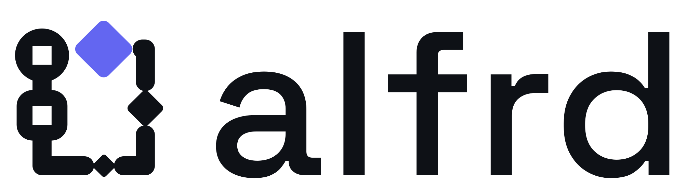
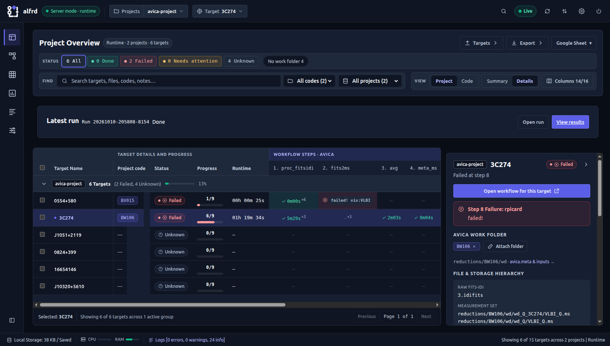

<p align="center">
  <picture>
    <source media="(prefers-color-scheme: dark)" srcset="https://raw.githubusercontent.com/avikhagol/alfrd/HEAD/docs/brand/alfrd-lockup-dark.svg">
    
  </picture>
</p>

<p align="center">
  Run your pipeline steps, see where every target stands, and pick up where you left off.
</p>

<p align="center">
  <a href="https://pypi.org/project/alfrd/"></a>
  
  <a href="LICENSE"></a>
</p>

<p align="center">
  <a href="https://raw.githubusercontent.com/avikhagol/alfrd/HEAD/docs/images/overview.png"></a>
</p>

**ALFRD** runs command-line pipelines across many targets, tracks progress in a CSV, and shows
status and logs in an offline web UI. Define your steps in `alfrd.yaml`. Built for radio astronomy
with [AVICA](https://avikhagol.github.io/avica-demos); works with any command-line pipeline.

## Install

Python 3.10+. Install with [uv](https://docs.astral.sh/uv/) (or `pip install alfrd`);

```bash
uv tool install alfrd
```

## Quick start

```bash
alfrd serve --demo
```

Try the demo at `http://127.0.0.1:5000/studio/`; **Ctrl+C** stops it. For your project,
[define `alfrd.yaml`](docs/configuration.md), then run `alfrd serve`. [Remote access →](docs/serve.md#stopping-and-remote-machines)

## What you can do

- **Track and compare targets:** status, failures, live logs, timings and run history.
- **Run and resume work:** select target × step cells in a plan CSV; resume unfinished steps.
- **Extend your workflow:** Claude Code ↔ Codex handoffs, notifications, plugins and themes.

## Harness mode

Harness mode is a chat-only view of a Chat session's agent team. The conversation is the page: the Studio
rail, top bar and footer are hidden, and the usual Chat session list and composer stay in place. Above the
thread, a one-line **Run card** shows the request title, status, tasks done, items that need you and cost.
Open it for a checklist of tasks with owner, latest activity and what each is waiting for; select a task to
see its details in a drawer. When something needs you, an attention bar opens a bounded panel with the
pending questions and decisions. The page reads existing plan events and task records; it never runs
recovery, starts models or writes project files.

The **Home** link in the top bar (and the page itself when the project has no session yet) shows a
dashboard of the project's sessions, grouped as *Needs you*, *Running* and *Recent*, with a composer to
start a new session.

| Key | Action |
|---|---|
| `/` | Focus the composer |
| `n` | Go to the next item that needs you |
| `c` | Open or close the Run card checklist |
| `Esc` | Close the drawer, checklist or decision panel |

Shortcuts are ignored while typing in a field. On screens up to 900px wide only one panel is open at a time.

```bash
alfrd harness --project <folder|registered-id> --chat <session-id> --no-open
```

| Flag | Meaning |
|---|---|
| `--project` | Project folder or registered id. Falls back to `harness.default_project`, then the current folder's manifest. |
| `--chat` | Existing chat session id (default: latest). |
| `--no-open` | Print the authenticated URL without opening a browser. |
| `--attach URL` | Attach to a running server. Cannot be combined with `--host`, `--port` or `--db`. |
| `--host`, `--port` | Local interface and port (default `127.0.0.1:5000`). If a harness-capable server already listens there, the command reuses it; an incompatible one is refused, never replaced. |
| `--db` | Runtime database for a newly started server. |

A newly started harness server only monitors: it skips reconcile, watch, scheduling and plugin services.

Optional `harness:` keys in `alfrd.yaml`; missing or malformed values fall back to these defaults:

```yaml
harness:
  default_project: null        # project used when --project is omitted
  stuck_after_minutes: 10      # a working task with no recorded progress for this long is "stuck"
  poll_seconds: 2              # live refresh interval
  role_order: [orchestrator, research, design, build, verify, fix]   # agent columns, left to right
```

Inside Harness, Chat is always shown, overriding the Superuser **Chat** toggle (the effective check is
`harness_mode OR superuser toggle`). This holds only in the harness page: your saved preference is not
changed, other pages behave as before, and server-side authorization is unchanged.

## Documentation

| Start here | Go further |
|---|---|
| [Studio guide](docs/studio-guide.md) · [Serve & screenshots](docs/serve.md) | [Agent loops](docs/agent-loops.md) · [Notifications](docs/notifications.md) |
| [Pipeline configuration](docs/configuration.md) · [Plans](docs/plans.md) | [Plugins & themes](docs/plugins.md) · [Python API](docs/python-api.md) |
| [Search](docs/search.md) · [Metadata panels](docs/template-views.md) | [Status API](docs/status-api.md) · [Changelog](CHANGELOG.md) |

[Report a bug or suggest a feature](https://github.com/avikhagol/alfrd/issues) ·
[Email](mailto:akumar@ia.forth.gr) · [Logo & usage](docs/brand/README.md) · [BSD-3-Clause license](LICENSE)

## Credits

Built in the SMILE project (“Search for Milli-Lenses”), funded by the European Research Council
(ERC), HORIZON ERC Grants 2021, grant agreement No. 101040021. If you use ALFRD, please link to
this repository in a footnote.
